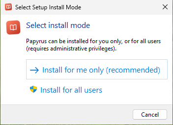
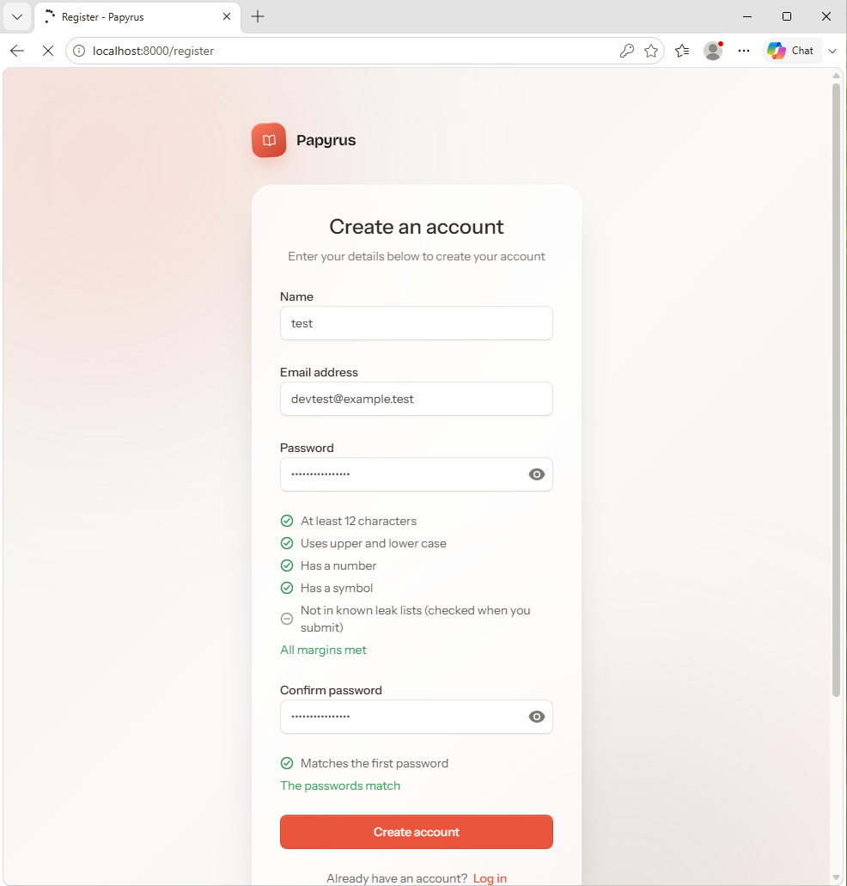
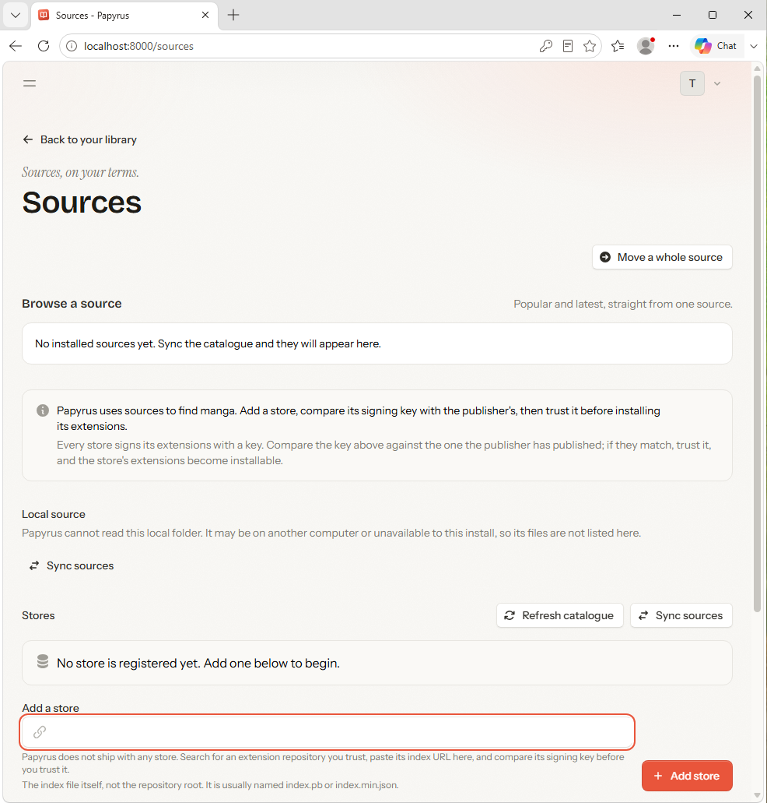

# From download to reading: a visual walkthrough

These are real screenshots from the 2026-11-04 manual installer run in Windows
Sandbox; `docs/ENGINEERING-NOTES.md` section 16.6 records that session. The
screenshots are from version 1.5.4. The guest had no PHP, Java or Papyrus
before the run, and the browser had one tab, so nothing from another tab is in
frame. Each image is cropped to the one window it shows.

The guide stays with what Papyrus puts on screen. Where an extension repository
comes from is [SOURCES.md](SOURCES.md)'s subject, not this page's. Papyrus does
not name, link or ship a store.

## 1. Install

Run the setup executable. It asks whether to install for you only or for all
users. Choose **Install for me only**: it needs no administrator rights, puts
the program under your profile, and keeps the library in
`%LOCALAPPDATA%\Papyrus`, where an update or an uninstall cannot reach it. The
wizard creates a desktop shortcut and a Start Menu entry, and the app starts
from either.

The installer is unsigned. Windows may show a warning before it runs; that is
expected, and the build record carries the SHA-256 of the file you downloaded.

## 2. The first run, and your account

Setup can open Papyrus when it finishes. If it does not, use the desktop
shortcut. Either way the app is at `http://127.0.0.1:8000`. The first account
created on a fresh install is the owner, so it can manage the server and its
sources. Later accounts are readers unless the owner changes that.

The form checks the password as you type: twelve characters, upper and lower
case, a number and a symbol. The name and address in the screenshot are
disposable test values; use your own.

## 3. The empty library is the correct first state

Papyrus ships with no sources. That is deliberate, and it is why the library is
empty on the first run. The page says what to do first:

> Papyrus reads from sources. A source is an extension repository that holds
> manga; Papyrus ships with none, so the first step is to add one.

**Add a source** is the first door. **Go to search** and **Bring a library from
another app** both need a source before they can return anything.

## 4. Add a store

Open **Sources**. No store is registered yet. Paste the **index URL** of an
extension repository you trust into **Add a store**. Papyrus does not name,
link or recommend one; the field is empty on a fresh install, and the URL in
the screenshot has been removed.

The URL must be the index file, not the repository root. It is usually named
`index.pb` or `index.min.json`. Once the store is added, its name, badge and
signing key appear. Compare the key with the one the publisher has published.
If they match, trust it. Trusting is what makes its extensions installable, and
it is the only step that does.

## 5. Install an extension

After a store is trusted, the **Available** view lists what it publishes. One
extension covers one site or one language variant; install the one that
matches what you read. This run installed **MangaTaro**.

Installed extensions appear as sources, and the Sources page groups the
language variants of the same site together, so one site does not fill the
page with flags.

## 6. Search every source

**Search every source** asks every runnable source at once. This run sent the
query to 2 of 2 sources and got 14 results, deduplicated from 2 sources. The
filters above the results narrow by language and content rating; the per-source
status shows which sources answered and which were left out.

A source that times out or cannot answer is counted rather than allowed to fail
the whole search.

## 7. Add the series, then read a chapter

Open a result and choose **Add to library**. The series page shows the cover,
the source it came from, its status and tags, and the chapter list. The list can
take a few seconds to arrive; the page says so while it fetches.

Choose a chapter. The reader shows one page at a time, saves your place, and
puts the chapter and page at the bottom of the screen. This run opened
`/read/1/1`, chapter 1 of 1,203.

## 8. The series remembers where you are

Back on the series, Chapter 001 is marked read and the header offers
**Continue reading**. The library lists the series, and the next chapter is one
press away. That is the loop: a store supplies extensions, an extension
supplies sources, a source supplies series, and Papyrus keeps the read state.

From here, [SOURCES.md](SOURCES.md) covers choosing between sources and what to
do when one breaks; [README.md](../README.md) covers the rest of the app.
